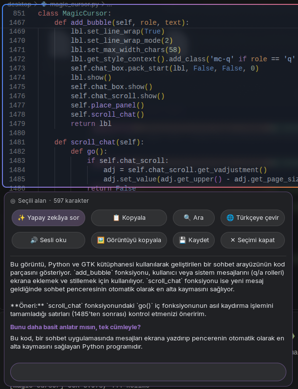

# ✦ Magic Cursor

Linux masaüstü için bağlamsal, yapay zekâ destekli imleç. Fareyi sallayınca açılır, ekranda imlecin altındaki şeyi anlar ve ne yapmak isteyebileceğini önerir.

*A context-aware, AI-assisted pointer for the Linux desktop (X11 / GNOME). Wiggle the mouse, hover anything on screen, get one-click actions or ask an AI about it.*

<p align="center"></p>

## Özellikler

- **Salla ve aç:** Fareyi hızlıca sağa sola salla ya da <kbd>Super</kbd>+<kbd>G</kbd>'ye bas. Gerçek imleç kısa bir savrulma animasyonu yapar, etrafında hafif bir ışıltı belirir.
- **Her uygulamada çalışır:** Ekran OCR ile okunur (Tesseract), yani tarayıcı, editör, PDF, terminal fark etmez.
- **Akıllı öneriler:** Üzerine geldiğin şeye göre:

  | Algılanan | Eylemler |
  |---|---|
  | 📅 Tarih / saat | Google Takvim'e ekle, `.ics` kaydet |
  | 📍 Adres | Haritada göster, yol tarifi |
  | 📞 Telefon | WhatsApp, ara, kopyala |
  | ✉️ E-posta · 🔗 Link | Yaz / aç, kopyala |
  | 💱 Fiyat | Döviz çevirisi |
  | 🎨 Renk kodu | HEX / RGB kopyala |
  | ✦ Metin | Açıkla (AI), çevir (AI), kopyala, ara, sesli oku, kelimenin anlamı |

- **Daire çizerek seç:** Mod açıkken sol tıkla basılı tutup bir alanın etrafını dolaş. O alanın metni ve görüntüsüyle işlem yapabilir, yapay zekâya sorabilirsin.
- **Devam soruları:** Groq (`qwen/qwen3.8-27b`, görsel destekli) yanıtını panelde akışlı olarak gösterir. Altındaki kutudan konuşmaya devam edebilirsin.
- **Akışını bozmaz:** Normal bir tıklama modu kapatır ve tıklamayı alttaki uygulamaya iletir.

## Gereksinimler

- Linux, **X11 oturumu** (Wayland desteklenmiyor) ve kompozitörlü bir masaüstü (GNOME'da test edildi)
- Python 3.10+ ve PyGObject (GTK 3)
- Tesseract OCR (Türkçe için `tur` dil paketi)
- Ücretsiz bir [Groq API anahtarı](https://console.groq.com/keys) (yalnızca yapay zekâ özellikleri için)

Debian / Ubuntu / Zorin:

```bash
sudo apt install python3-gi python3-gi-cairo gir1.2-gtk-3.0 \
                 tesseract-ocr tesseract-ocr-tur tesseract-ocr-eng \
                 libxtst6 libxfixes3 speech-dispatcher
```

## Kurulum

```bash
git clone https://github.com/0xREISUB/magic-cursor.git
cd magic-cursor/desktop
./install.sh
```

`install.sh` şunları yapar:
- girişte otomatik başlatmayı ekler (`~/.config/autostart/magic-cursor.desktop`),
- <kbd>Super</kbd>+<kbd>G</kbd> kısayolunu tanımlar,
- ayar dosyasını oluşturur,
- programı hemen başlatır.

Ardından Groq anahtarını `~/.config/magic-cursor/config.json` dosyasına ekle:

```json
{
  "groq_api_key": "gsk_...",
  "groq_model": "qwen/qwen3.8-27b"
}
```

Anahtarı ekledikten sonra programı yeniden başlat: `python3 magic_cursor.py quit && python3 magic_cursor.py &`

Kaldırmak için `./uninstall.sh` çalıştır. Ayar dosyan silinmez.

## Kullanım

| Ne yaparsın | Ne olur |
|---|---|
| Fareyi salla / <kbd>Super</kbd>+<kbd>G</kbd> | Magic mod açılır veya kapanır |
| Bir şeyin üzerine gel | Vurgulanır, ~0.3 sn sonra öneri paneli çıkar |
| Sol tıkla basılı tut + daire çiz | Alan seçilir |
| ✨ Açıkla / Yapay zekâya sor | Groq yanıtı gelir, altına devam sorusu yazabilirsin |
| Normal tıklama, tekerlek, ✕ | Mod kapanır, tıklama uygulamaya iletilir |
| <kbd>Esc</kbd> (panel odaktayken) | Paneli kapatır |

Komut satırından:

```bash
python3 desktop/magic_cursor.py          # arka planda çalıştır
python3 desktop/magic_cursor.py toggle   # aç / kapat
python3 desktop/magic_cursor.py quit     # kapat
```

Ortam değişkenleri: `GROQ_API_KEY`, `MAGIC_CURSOR_MODEL`, `MAGIC_CURSOR_WIGGLE=0` (sallamayı kapatır).

### Oyunlar ve tam ekran

Sallamayla açılma şu durumlarda kendiliğinden devre dışı kalır (<kbd>Super</kbd>+<kbd>G</kbd> her zaman çalışır):
- ön plandaki pencere **tam ekransa** (oyun, video, sunum),
- pencere bir **oyunsa**: Steam (`steam_app_*`, `reaper`, `pressure-vessel`), Proton/Wine, Lutris, Heroic, gamescope, `.exe` süreçleri ve yaygın emülatörler.

### Ek ayarlar (`config.json`)

```json
{
  "groq_api_key": "gsk_...",
  "block_fullscreen": true,
  "blocked_apps": ["obs", "blender"],
  "wiggle": {"stroke_px": 70, "flips": 6, "window_s": 1.0}
}
```

- `blocked_apps`: sallamayla açılmasını istemediğin uygulamalar (pencere sınıfı veya süreç adında geçen parça).
- `wiggle`: sallama hassasiyeti. Daha zor tetiklemek için `stroke_px` ya da `flips` değerini artır, daha kolay tetiklemek için azalt.

## Nasıl çalışır?

1. Mod açılınca ekranın bir görüntüsü alınır ve Tesseract ile arka planda, düşük öncelikle okunur.
2. Tesseract'ın kitap odaklı paragraf gruplaması yerine kelimeler ekrana uygun şekilde yeniden gruplanır. Önce satırlara (sütun ve panel boşlukları satırı böler), sonra hizalı ve aynı yazı boyutundaki satırlardan bloklara.
3. Her blokta tarih, adres, telefon, fiyat gibi kalıplar düzenli ifadelerle aranır.
4. Vurgulama, panel ve ışıltı küçük, ayrı pencerelerdir. Ekranı kaplayan tek şey, sürüklemeyi yakalamak için kullanılan şeffaf bir giriş katmanıdır. Bu katmanda panelin ve durum çubuğunun yerinde delik vardır.
5. Normal tıklamalar XTest ile alttaki uygulamaya yeniden gönderilir. Açılış animasyonunda gerçek imleç XFixes ile kısa süre gizlenir ve yerine sistemin imleç görüntüsü döndürülerek çizilir.

## Proje yapısı

```
desktop/
  magic_cursor.py      başlatıcı (install.sh ve kısayol bunu çalıştırır)
  install.sh / uninstall.sh
  magiccursor/
    app.py             ana döngü: imleç takibi, sallama, aç/kapat, tarama, hover, alan seçimi
    panel.py           öneri paneli ve hedefe göre eylem çipleri
    chat.py            panel içindeki Groq sohbeti ve devam soruları
    entities.py        tarih, adres, telefon, e-posta, link, fiyat, renk tanıma
    ocr.py             Tesseract + ekrana uygun bölümlendirme (satır → blok)
    actions.py         takvim, harita, çeviri, sesli okuma gibi eylemler
    groq.py            Groq istemcisi (görsel + konuşma geçmişi, akışlı)
    glow.py            imleç ışıltısı ve savrulma animasyonu
    selector.py        daire çizerek seçim için şeffaf giriş katmanı
    widgets.py         CSS, şeffaf pencereler, vurgulama çerçevesi
    x11.py             XFixes (imleci gizle) ve XTest (tıklamayı ilet)
    config.py          sabitler ve ayar dosyası
    ipc.py / main.py   tek örnek kontrolü, komut satırı
web/                   tarayıcı sürümü (magic-cursor.js) ve demo
```

## Bilinen sınırlamalar

- Yalnızca X11'de çalışır. Wayland, uygulamaların ekranı okumasına ve global fare takibine izin vermez.
- Koyu temalı kod editörlerinde OCR bazı kelimeleri (özellikle alt çizgili olanları) kaçırabilir.
- Mod açıkken uygulamalarda sürükle-bırak yapılamaz, çünkü sol tıkla sürükleme alan seçimidir. Bir tıklama normal kullanıma döndürür.
- Ekran görüntüsü mod açıldığı anda alınır. Mod açıkken ekran değişirse yeniden açmak gerekir.

## Web sürümü

[`web/`](web/) klasöründe, herhangi bir web sayfasına tek satırla eklenebilen bir JavaScript sürümü var:

```html
<script src="magic-cursor.js"></script>
```

Demo için `web/index.html` dosyasını tarayıcıda aç.

## Lisans

[MIT](LICENSE)

Bu proje bağımsız bir açık kaynak çalışmadır. Google LLC ile bağlantılı değildir, Google tarafından desteklenmez ve onaylanmamıştır. Google, Google Takvim, Google Haritalar, Google Çeviri ve Google Lens, Google LLC'nin ticari markalarıdır. Bu projede yalnızca ilgili hizmetlere bağlantı açmak için anılırlar.
